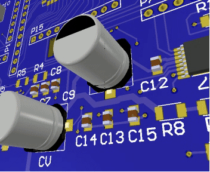

  

## Hardware

The Altium Designer project is in [`altium/`](altium/). Open `altium/aboalrobotatESP32S2.PrjPcb`.

Gerber and drill files for the current board are in
[`altium/Project Outputs for aboalrobotatESP32S2/`](<altium/Project Outputs for aboalrobotatESP32S2/>).

### Third-party parts

Footprints, symbols and 3D models from third-party libraries are embedded in
the schematic and PCB documents, so the project opens, builds and exports
without them. The library files themselves are **not** included in this repo
and are not covered by its licenses.

To add or swap one of these parts, download its library from
[SnapEDA](https://www.snapeda.com/) (or the manufacturer) and install it in Altium.
Parts used include ESP32-S2-SOLO-U-N4R2, DRV8833PWPR, CH340G, USB4105-GF-A,
NCP1117STAT3G, MIC5205-2.5YM5-TR, HC-SR04 and GY-521.

## License

This repo uses two licenses:

| Part | License |
|------|---------|
| Firmware | [MIT License](LICENSE) |
| Hardware design files (`altium/`: Altium schematics, PCB layout, project outputs) | [CERN Open Hardware Licence v2 – Permissive (CERN-OHL-P-2.0)](altium/LICENSE) |

Copyright (c) 2024-2026 naifaljohani
